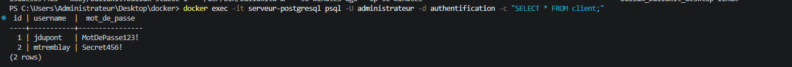
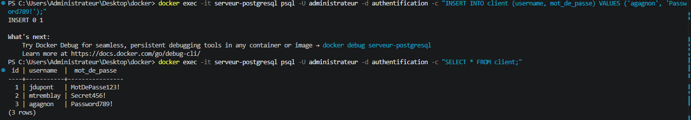
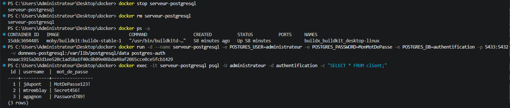
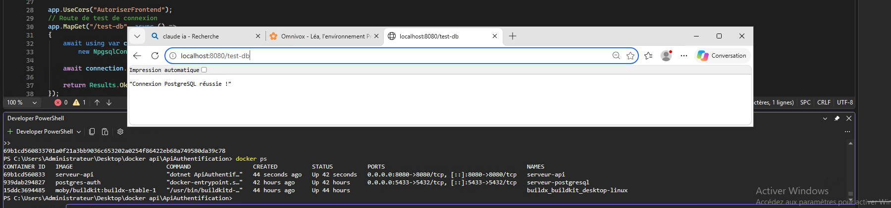
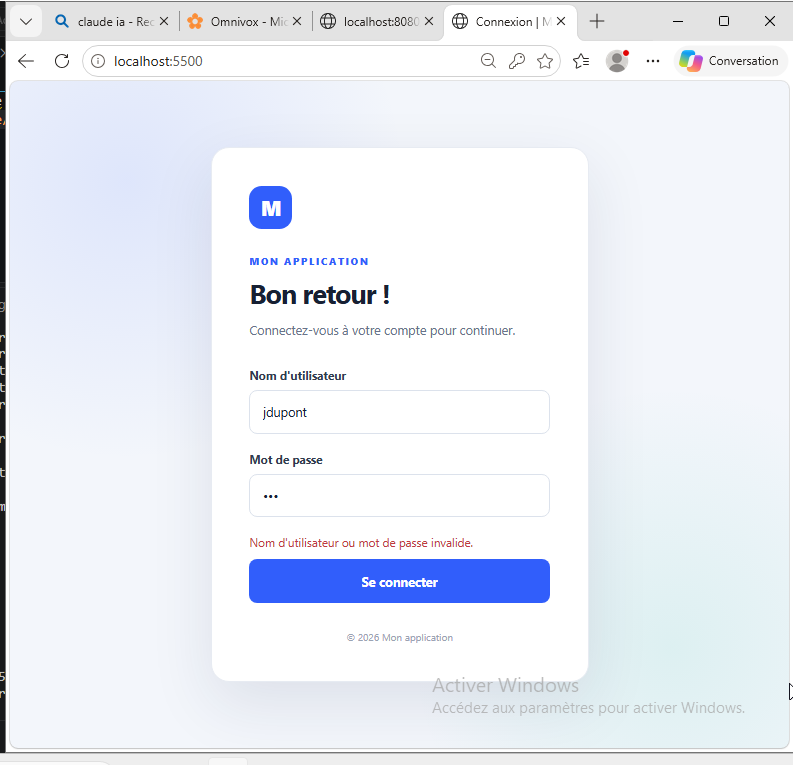
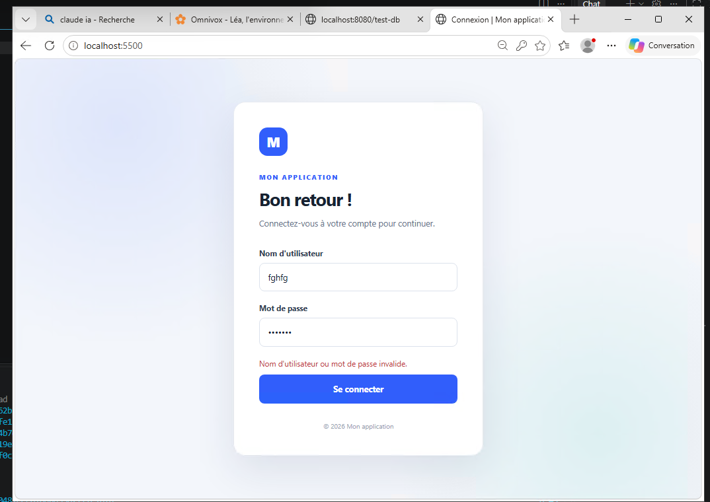
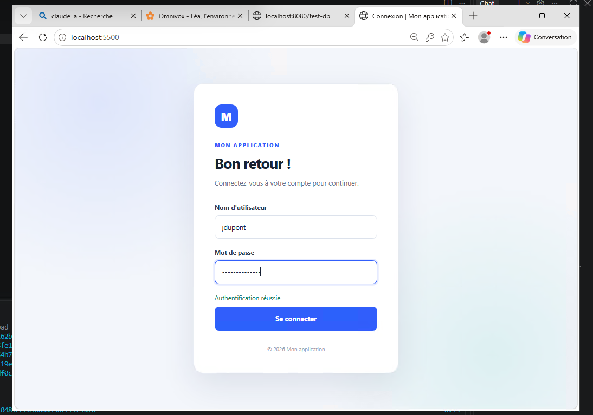
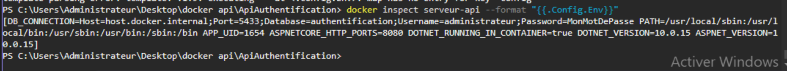
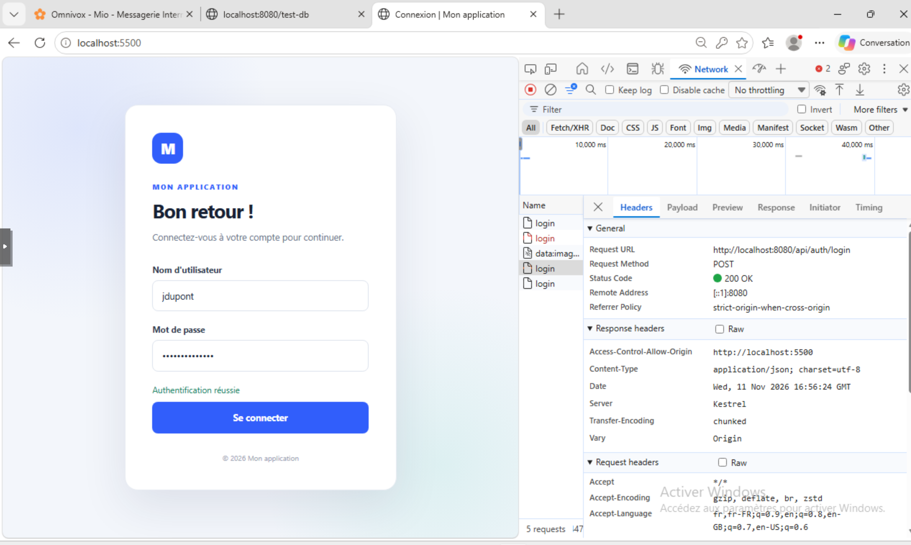
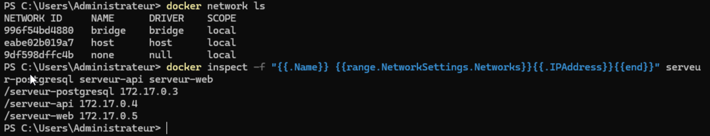

  # Laboratoire Docker — Partie 1 : Serveur PostgreSQL
  Image PostgreSQL personnalisée qui initialise automatiquement la base `authentification` avec une table `client`.

# Docker Hub
https://hub.docker.com/r/augustind2l/serveur-postgresql

# Commandes de mise en place
## on construit l'image avec la commande 
```
docker build --load -t postgres-auth .
``` 
le `--load` sert pour enregistrer l'image dans Docker

## créer le volume avec la commande 
```
docker volume create donnees-postgresql
```

## on lance le conteneur avec les paramètres demandés avec la commande 
```
docker run -d --name serveur-postgresql -e POSTGRES_USER=administrateur -e POSTGRES_PASSWORD=MonMotDePasse -e POSTGRES_DB=authentification -p 5433:5432 -v donnees-postgresql:/var/lib/postgresql/data postgres-auth
```

# Vérification de la persistance
## Vérifier qu'on commence bien avec deux clients

## Ajouter un troisième client
```
docker exec -it serveur-postgresql psql -U administrateur -d authentification -c "INSERT INTO client (username, mot_de_passe) VALUES ('agagnon', 'Password789!');"
```

## Arrêter et supprimer le conteneur
```
docker stop serveur-postgresql
docker rm serveur-postgresql
```
## Recréer le conteneur avec le même volume
```
docker run -d --name serveur-postgresql -e POSTGRES_USER=administrateur -e POSTGRES_PASSWORD=MonMotDePasse -e POSTGRES_DB=authentification -p 5433:5432 -v donnees-postgresql:/var/lib/postgresql/data postgres-auth
```
## Vérifier que les trois clients sont présents
```
docker exec -it serveur-postgresql psql -U administrateur -d authentification -c "SELECT * FROM client;"
```


# Publication sur Docker Hub

## Renommer l'image selon la nomenclature demandée
```
docker tag postgres-auth:latest augustind2l/serveur-postgresql:1.0
```
`docker tag` ajoute un deuxième nom à l'image locale `postgres-auth` sans la copier. Le nouveau nom suit la forme `utilisateur/dépôt:version` exigée par Docker Hub.

## Se connecter à Docker Hub
```
docker login
```
Authentifie le poste avec le compte `augustind2l`, ce qui est nécessaire pour publier une image.

## Publier l'image
```
docker push augustind2l/serveur-postgresql:1.0
```
Envoie l'image dans le dépôt public `augustind2l/serveur-postgresql` avec le tag `1.0`.

## Récupérer l'image sur une autre machine
```
docker pull augustind2l/serveur-postgresql:1.0
```
Télécharge l'image publiée. On peut ensuite lancer le conteneur avec la même commande `docker run`, en remplaçant `postgres-auth` par `augustind2l/serveur-postgresql:1.0`.

# Questions
1. Quelle est la différence entre une image et un conteneur Docker ? 
   >L’image est un modèle figé, en lecture seule (comme une classe). Le conteneur est une instance qui tourne à partir de cette image (comme un objet). On peut lancer plusieurs conteneurs à partir d’une même image.
2. Quelle est la différence entre EXPOSE et -p ? 
   >`EXPOSE` (dans le Dockerfile) ne fait que documenter le port sur lequel l’application écoute dans le conteneur, sans rien ouvrir. `-p 5433:5432` (dans `docker run`) crée réellement le lien entre un port de l’hôte et un port du conteneur.
3. Pourquoi utilise-t-on un volume Docker pour conserver les données ? 
   >Un conteneur est éphémère. Quand on le supprime, tout ce qui a été écrit à l’intérieur disparaît. Le volume est un stockage géré par Docker, séparé du conteneur, donc les données survivent à sa suppression ou à son remplacement.
4. Pourquoi le script d'initialisation SQL ne s'exécute-t-il pas à chaque démarrage du conteneur ?
   >L’image postgres n’exécute les fichiers de /docker-entrypoint-initdb.d/ que si le dossier de données est vide, c’est-à-dire au tout premier démarrage.

# Laboratoire Docker — Partie 2 : API d'authentification et site Web
Ajout de deux services à l'infrastructure de la partie 1 : une API d'authentification ASP.NET Core qui vérifie les identifiants dans la base PostgreSQL, et un site Web statique servi par Nginx qui permet aux utilisateurs de se connecter. Les Dockerfile des deux parties sont joints à la remise.

# Docker Hub
- Site Web : https://hub.docker.com/r/augustind2l/serveur-web
- API : https://hub.docker.com/r/augustind2l/serveur-api

# Partie Web
## Le Dockerfile
Le Dockerfile part de l'image `nginx:alpine`, un serveur Web léger, et copie les fichiers HTML, CSS et JavaScript dans `/usr/share/nginx/html`, le dossier que Nginx sert par défaut sur son port 80.

## On construit l'image avec la commande
```
docker build -t serveur-web .
```
`-t` donne le nom `serveur-web` à l'image, et le `.` indique que le contexte de build est le dossier courant, celui qui contient le site et le Dockerfile.

## On lance le conteneur avec la commande
```
docker run -d --name serveur-web -p 5500:80 serveur-web
```
- `-d` lance le conteneur en arrière-plan.
- `--name serveur-web` donne au conteneur le nom demandé.
- `-p 5500:80` relie le port 5500 de l'hôte au port 80 du conteneur, sur lequel Nginx écoute.

On utilise 5500 côté hôte parce que c'est le port de Live Server utilisé pendant le développement, et surtout celui autorisé dans la politique CORS de l'API. Avec un autre port, le navigateur bloquerait les appels à l'API.

Le JavaScript du site ne s'exécute pas dans le conteneur, mais dans le navigateur. Le conteneur ne fait que livrer les fichiers.

# Publication du site Web sur Docker Hub
## Renommer l'image selon la nomenclature demandée
```
docker tag serveur-web:latest augustind2l/serveur-web:1.0
```
`docker tag` ajoute un deuxième nom à l'image locale `serveur-web` sans la copier. Le nouveau nom suit la forme `utilisateur/dépôt:version` exigée par Docker Hub.

## Se connecter à Docker Hub
```
docker login
```
Authentifie le poste avec le compte `augustind2l`, ce qui est nécessaire pour publier une image.

## Publier l'image
```
docker push augustind2l/serveur-web:1.0
```
Envoie l'image dans le dépôt public `augustind2l/serveur-web` avec le tag `1.0`.

# Partie API
## Le Dockerfile
Le Dockerfile est généré par Visual Studio : clic droit sur le projet > **Ajouter** > **Prise en charge des conteneurs**, on choisit **Linux** et on laisse les paramètres par défaut.

C'est un Dockerfile en plusieurs étapes : l'image `dotnet/sdk` compile et publie le projet, puis seul le résultat publié est copié dans l'image `dotnet/aspnet`, qui ne contient que l'environnement d'exécution. L'image finale est ainsi beaucoup plus légère. Le port 8080 correspond à celui imposé dans `Program.cs` (`UseUrls("http://+:8080")`).

## On construit l'image avec la commande
```
docker build --load -f ApiAuthentification/Dockerfile -t serveur-api .
```
La commande se lance depuis le **dossier de la solution**, et non depuis celui du projet. Le Dockerfile généré par Visual Studio copie `ApiAuthentification/ApiAuthentification.csproj`, il s'attend donc à ce que le contexte de build (le `.`) soit le dossier parent. Comme le Dockerfile ne se trouve pas dans ce dossier, `-f` indique son emplacement.

## On lance le conteneur avec la commande
```
docker run -d --name serveur-api -p 8080:8080 `
  -e "ConnectionStrings__PostgreSQL=Host=host.docker.internal;Port=5433;Database=authentification;Username=administrateur;Password=MonMotDePasse" `
  serveur-api
```
- `-p 8080:8080` relie le port 8080 de l'hôte au port 8080 du conteneur.
- `-e` définit une variable d'environnement qui remplace la chaîne de connexion de `appsettings.json`. Le double soulignement `__` représente un niveau d'imbrication du JSON : `ConnectionStrings__PostgreSQL` correspond à la clé `PostgreSQL` dans la section `ConnectionStrings`.
- `Host=host.docker.internal` désigne la machine hôte vue depuis le conteneur. Dans un conteneur, `localhost` désigne le conteneur lui-même, pas la machine Windows.
- `Port=5433` est le port publié sur l'hôte par le conteneur PostgreSQL, qui redirige vers son port 5432.

La connexion passe donc par l'hôte : conteneur API → machine Windows (port 5433) → conteneur PostgreSQL (port 5432), sans réseau Docker personnalisé.

## Vérification de la connexion à PostgreSQL
Avec les deux conteneurs lancés, la route de test de l'API confirme que la connexion à la base fonctionne :
```
http://localhost:8080/test-db
```


# Publication de l'API sur Docker Hub
## Renommer l'image selon la nomenclature demandée
```
docker tag serveur-api:latest augustind2l/serveur-api:1.0
```

## Se connecter à Docker Hub
```
docker login
```

## Publier l'image
```
docker push augustind2l/serveur-api:1.0
```
Envoie l'image dans le dépôt public `augustind2l/serveur-api` avec le tag `1.0`.

# Tests et validation
1. Accédez au site Web à partir du navigateur en utilisant l'adresse IP de votre machine 
Windows et le port 8080. 
   >
2. Tentez une connexion avec un mauvais mot de passe. 
   >
3. Tentez une connexion avec un utilisateur inexistant.
   > 
4. Connectez-vous avec un utilisateur valide présent dans la base de données PostgreSQL. 
   >
5. Vérifiez que vous êtes redirigé vers la page bidon après une authentification réussie. 
   > Aucune redirection n'à été implémentée
## Validation des communications réseau : 
6. Démontrez que l'API communique correctement avec PostgreSQL en passant par 
l'adresse IP de la machine Windows. 
   >
   >
7. Démontrez que le site Web communique correctement avec l'API en passant par 
l'adresse IP de la machine Windows. 
   >
8. Vérifiez que l'application fonctionne sans utiliser les adresses IP internes des conteneurs 
ni les noms d'hôte Docker.
   >
